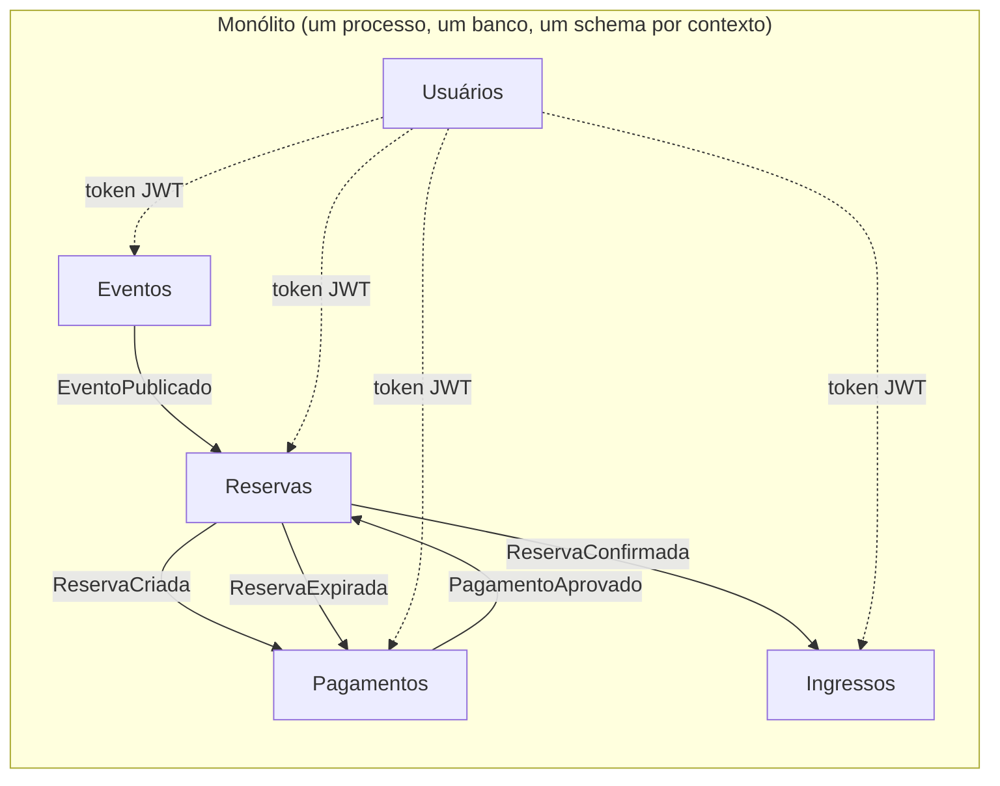
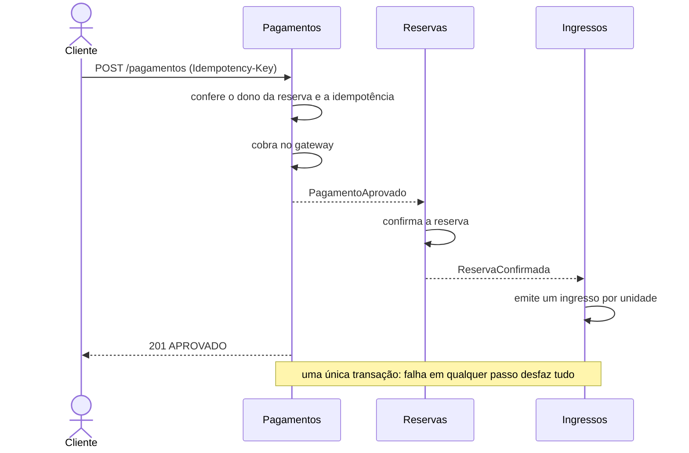

# Bilheteria: monólito (TCC, PUCRS)

Sistema de reserva e venda de ingressos inspirado no Alf.io. É o estudo de caso de um TCC que **compara uma
arquitetura monolítica com uma de microsserviços**, com o mesmo domínio nas duas. Este repositório contém a
**versão monolítica** (TC1). A versão de microsserviços e os testes de carga ficam para o TC2.

- Autor: Pedro Henrique Schneider Conzatti, Sistemas de Informação, PUCRS
- Orientadora: Profa. Dra. Ana Paula Terra Bacelo
- Stack: Java 21, Spring Boot 4.1.1, PostgreSQL 16, Flyway, Docker, Micrometer, Prometheus, Grafana

## O que o sistema faz

Organizadores publicam eventos com categorias de ingresso. Clientes reservam (a reserva segura os ingressos por
15 minutos), pagam e recebem um ingresso com código único. A portaria faz o check-in, que só vale uma vez.
Duas garantias são o coração do estudo: **nunca vender mais que a capacidade** (mesmo com centenas de pedidos
simultâneos) e **nunca cobrar nem emitir em duplicidade** (idempotência).

## Arquitetura em uma página

Monólito modular com arquitetura hexagonal "leve": cada contexto tem `domain` (Java puro), `application`
(serviços e portas) e `adapter` (REST, JPA, listeners, jobs). Os contextos **não se chamam diretamente**: só
trocam eventos de integração definidos em `compartilhado/contratos`.



No monólito, o pagamento aprovado percorre toda a cadeia **dentro de uma única transação**:



Decisões e motivos: [`docs/adr`](docs/adr). Onde está cada coisa: [`docs/RASTREABILIDADE.md`](docs/RASTREABILIDADE.md).
Como isto vira microsserviços: [`docs/EVOLUCAO-MICROSSERVICOS.md`](docs/EVOLUCAO-MICROSSERVICOS.md).

## Requisitos

JDK 21 e Docker (o Docker Desktop precisa estar aberto: os testes usam Testcontainers).

## Como rodar

### Testes

```powershell
./mvnw.cmd test      # Windows
./mvnw test          # Linux/macOS
```

Cobrem domínio, serviços, integração com PostgreSQL real, concorrência (50 threads disputando 10 ingressos;
10 check-ins simultâneos do mesmo código), idempotência, segurança, observabilidade, contrato OpenAPI,
regras de arquitetura (ArchUnit, Spring Modulith) e o verificador de consistência.

### Sistema completo (app + Postgres + Prometheus + Grafana)

```powershell
docker compose up -d --build
docker compose ps
```

| O quê | Endereço |
|---|---|
| API | http://localhost:8081 |
| Documentação (Swagger UI) | http://localhost:8081/swagger-ui.html |
| Métricas | http://localhost:8081/actuator/prometheus |
| Prometheus | http://localhost:9090 |
| Grafana (admin / admin), dashboard "Bilheteria - Monólito" | http://localhost:3000 |

Para desligar: `docker compose down` (mantém o banco) ou `docker compose down -v` (apaga o banco).

> As credenciais abaixo e o `JWT_SEGREDO` do `docker-compose.yml` são **somente de laboratório**.

| Papel | E-mail | Senha |
|---|---|---|
| Organizador | organizador@bilheteria.local | organizador-123 |
| Portaria | portaria@bilheteria.local | portaria-123 |
| Cliente | cadastre-se em `POST /usuarios` | (mínimo de 8 caracteres) |

### Demonstração do fluxo completo

```powershell
./scripts/demonstracao.ps1
```

Cria evento, reserva, paga, emite os ingressos, faz o check-in e roda o verificador de consistência.

### Verificar a consistência do banco

```powershell
./scripts/verificar-consistencia.ps1     # 0 = consistente, 1 = invariante violado, 2 = falha ao executar
```

São 15 invariantes (ex.: ingressos emitidos nunca excedem a capacidade). Usado ao fim de cada teste de carga.

### Variáveis dos experimentos

```powershell
$env:POOL_DE_CONEXOES = "20"; $env:LATENCIA_DO_GATEWAY = "PT0.3S"; docker compose up -d
```

## Estrutura

```
src/main/java/br/pucrs/tcc/bilheteria/
  compartilhado/   kernel (tipos sem framework), contratos (eventos de integração), infra (segurança, métricas, erros)
  eventos/  reservas/  pagamentos/  ingressos/  usuarios/
      domain/          regras de negócio, Java puro
      application/     serviços e portas (interfaces)
      adapter/in/      REST, listeners de eventos, jobs
      adapter/out/     JPA, gateway de pagamento, gerador de código, JWT, BCrypt
src/main/resources/db/migration/   V1..V7 (Flyway)
scripts/                           verificador de consistência e demonstração
observabilidade/                   Prometheus e Grafana (provisionados por arquivo)
docs/                              ADRs, rastreabilidade, evolução para microsserviços
```

## Limitações conhecidas (estado do TC1)

- Só a versão monolítica existe; microsserviços e testes de carga (k6) são o TC2.
- Pagamento é **simulado** (`GatewaySimulado`); a chamada ao gateway acontece dentro da transação.
- JWT HS256 com segredo compartilhado, sem refresh nem revogação; sem limite de tentativas de login,
  recuperação de senha ou verificação de e-mail. Sem HTTPS nem CORS.
- Métricas de negócio contam o evento publicado, não o commit do banco de dados.
- `/actuator/prometheus` e a documentação OpenAPI são públicos (laboratório).
- `GET /pagamentos/{id}` é restrito ao organizador (o pagamento não guarda o usuário).
- O check-in não valida a data do evento.
- Sem tracing distribuído nem agregação de logs.